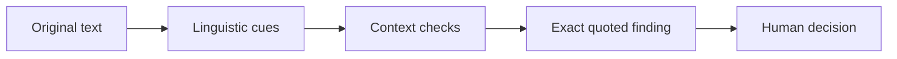

# Communication Check

**A clearer message. Still your voice.**

A focused portfolio prototype for reviewing customer onboarding follow-up emails.
[Try the September 11 hosted demo](https://communication-check-preview.onrender.com).
The September 16 tone/review update described here is verified locally and has not
been deployed to that preview.

## The problem

A follow-up email can sound clear to its writer while leaving the customer unsure
who acts next, what takes priority, or whether a promise has been confirmed. I
explored a short review step for B2B SaaS account managers and customer-success
managers. This is a product hypothesis; customer demand and business impact have
not been validated.

## The experience

Paste a draft or try one of three fictional examples. Clarity & commitments
shows up to three prompts. Optional Tone & warmth shows up to two wording cues
using a chosen Direct, Collaborative or Warm preference. Open a finding, select
its exact wording to edit, or keep it as written. Keep marks Reviewed with Undo;
unchanged rechecks preserve decisions. Text edits clear both reviews; changing
style clears tone only. Copy always uses the current draft.

Warm paper, charcoal text, restrained plum accents and editorial typography give the
product a calm, focused feel. The desktop layout places the draft beside its
review. On smaller screens, the same sequence becomes a single column. Clear
focus states, keyboard controls and precise evidence selection support the core
workflow.

The product asks the writer to confirm a commitment. It never claims to know what
was agreed, assigns no score, and does not rewrite or send the email. Empty clarity
results retain the facts/agreements caveat; empty tone results explain the limited
coverage and inability to predict a recipient’s response.

## How it works

Text equivalent: Original text → linguistic cues → context checks → exact quoted
finding → human decision.

Communication Check keeps the original draft and its character positions so a
finding can select the exact wording, including repeated phrases and emoji.
Local deterministic TypeScript rules recognize a bounded set of linguistic cues:
for example, a definite product commitment or an addressed sweeping accusation.

Context checks are limited rules and suppressions. They exclude recognized
quoted history and signatures and handle supported qualifications; tone review
also avoids quoted units and some conditional or reported wording. They do not
understand a previous call, verify an agreement or establish how someone feels.
The diagram is a conceptual guide, not the literal order of every engine step.

A finding pairs an exact quote with a review prompt. Tone prompts reflect the
writer’s chosen intent. The writer can keep the wording, undo that decision, or
select it and edit; the app never rewrites or sends it.

Local processing makes behavior inspectable and avoids a remote model or
inference-service dependency. Runtime checks observed no draft-bearing network
traffic, logs or browser persistence. Static assets still load from the host;
explicit copy writes to the clipboard. AI assisted development, but no AI model
runs when a draft is checked.

Unfamiliar wording and nuance can be missed. Intent is a review preference, not
a comprehensive tone judgment. Passing development checks does not establish
factual correctness or production-level accuracy.

**Verified fictional example** — local tone engine, Collaborative intent:

- Input: “You always ignore our requests. Please send the workspace list by Thursday.”
- Exact emitted quote: “You always ignore our requests.”
- Review question: “Would naming the specific missed action and a shared next step help coordinate the follow-up?”
- Possible human decision: select the wording and describe the specific missed request, then recheck; or keep it as written. Neither action verifies the underlying facts.

## What was delivered

The September 11 delivery includes a hosted preview, three interactive demos,
portfolio screenshots, a walkthrough script and a documented rollback path.
The September 16 follow-on adds the Canvas3 layout, optional tone review and
keep/undo interactions in the existing local app. The hosted preview is unchanged.

Fresh local validation on September 16 passes **307 engine tests** (225 existing
clarity tests and 82 new tone development tests), **seven setup/integrity checks**,
build/typecheck/source guards and **43 browser checks**. Browser coverage includes
both review lenses, editing, current-text clipboard/fallback, exact evidence,
keyboard access, responsive layout and runtime privacy/offline behavior.
[Local screenshots](screenshots/README.md) include 1440, 1024, 390 and 320px widths,
evidence selection, enlarged text and 200% content zoom.

Two Astra High workers implemented disjoint UI and tone changes; the lead
integrated and validated them. Independent final review is recorded in
[verification](VERIFICATION.md). Automated browser and agent checks are not a full
accessibility certification, physical-device testing or human usability study.

## What I learned

Passing tests on known examples did not establish broad language coverage. All
ten reserved fictional evaluations missed the original detection target; the
latest detected 4 of 12 selected issues, with no flags across its four clean
controls. Those results remain visible in the evaluation report.

I chose to ship the polished portfolio prototype and stop the deeper parser
experiment for this delivery. The result demonstrates product scope, interaction
design, browser-local implementation and an honest approach to validation. It is
not presented as a reliable general-purpose writing assistant. Future product
work would start with real user feedback and a deliberate decision about detection
quality before expanding the scope.

## Preserved evaluation history

Every reserved attempt missed the original target of at least 10/12 selected
findings. These small fictional sets are not estimates of real-world accuracy.
No thresholds, labels or historical results were changed for portfolio delivery.

| Attempt | Expected findings detected | Useful emissions | Clean-control flags |
| --- | --- | --- | --- |
| V1 | 9/12 | 9/10 | 1 |
| V2 | 4/12 | 4/4 | 0 |
| V3 | 6/12 | 6/6 | 0 |
| V4 | 6/12 | 6/6 | 0 |
| V5 | 7/12 | 7/7 | 0 |
| V6 | 6/12 | 6/6 | 0 |
| V7 | 6/12 | 6/6 | 0 |
| V8 | 8/12 | 8/8 | 0 |
| V9 | 5/12 | 5/5 | 0 |
| V10 | 4/12 | 4/4 | 0 |

Detailed methods and preserved aggregate records remain in docs/EVALUATION.md.
