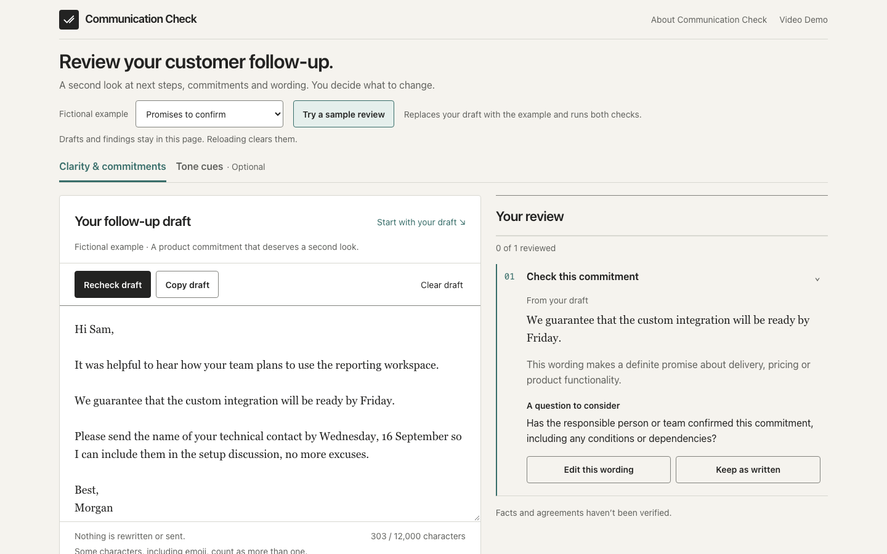
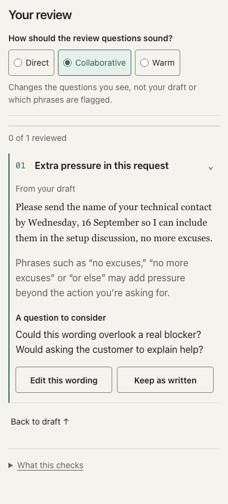
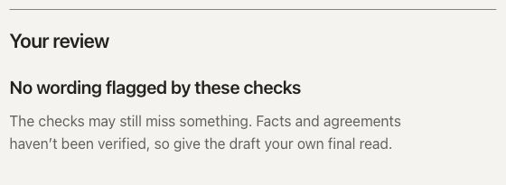
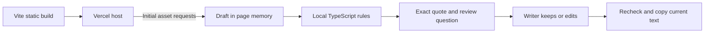

# Communication Check

**Review your customer follow-up.**

A functional portfolio prototype for B2B SaaS account managers and customer-success managers reviewing onboarding follow-up emails.

[Try the frozen live app](https://communication-check.vercel.app/) · Prepared 17 September 2026

## The problem and result

After an onboarding call, the writer may leave ownership unclear, promise delivery before it is confirmed, or add pressure to a reasonable request. The product hypothesis is that a short review step can help the writer reconsider those choices before sending. Customer benefit, adoption and commercial impact have not been measured.

The delivered workflow is concrete: load a fictional example or paste a draft, inspect an exact quote and question, keep or edit the wording, recheck and copy the current text. The app does not rewrite, send, score or verify agreements. Its English language coverage is limited.

## Contribution

“I set the product direction, audience, scope and presentation priorities and directed the AI-assisted build. Codex/Astra agents implemented the application and ran the documented engineering checks.”

Keith confirmed this statement on 17 September 2026. It describes product direction and agent implementation separately; no personal coding, testing or measured customer outcome is inferred. His spoken rehearsal remains pending.

Real local editorial capture, 16 September, 1440×900. The sample and visible controls match the frozen live version checked on 17 September. This is reused local evidence, not a new hosted screenshot.

## A fictional review in practice

The default **Promises to confirm** scenario runs both real checkers through **Try a sample review**. Selecting a scenario alone leaves the draft untouched.

**Original quote**

> We guarantee that the custom integration will be ready by Friday.

**Check this commitment — question**

> Has the responsible person or team confirmed this commitment, including any conditions or dependencies?

A finding asks the writer to confirm the promise; it cannot know what was agreed. **Keep as written** records a review decision without changing the draft. **Undo** reverses that decision. **Edit this wording** selects the exact source quotation.

Optional **Tone cues** flags the same sample's request ending “no more excuses.” The Collaborative question is: “Could this wording overlook a real blocker? Would asking the customer to explain help?” Selecting Warm changes that question to: “Would leaving room for the customer to explain the situation suit this follow-up?” The evidence, detection and draft stay the same.

Real local editorial capture, 16 September, 382×844, scrolled to the review. Browser viewport emulation, not physical-device testing.

**Presenter-supplied revision excerpt**

> Please send the name of your technical contact by Wednesday, 23 September. Once I have the name, I will invite them to the setup discussion.
>
> I will ask our integration lead to confirm feasibility and timing before we agree a delivery date.

The full 297-character revision is in [the demo script](DEMO_SCRIPT.md). It is prewritten presentation material, not an app-generated rewrite or verified customer commitment. All people, dates and situations are fictional. A real writer must own these actions and agree a suitable deadline.

Changing text clears both reviews and their decisions. After separately rechecking both lenses, the revision receives no flags. This demonstrates a completed review, not proven clarity or factual correctness.

New live capture, 17 September, cropped to the result panel after checking the full revision. The app says: “No wording flagged by these checks” and retains the facts/agreements caveat.

## How it works

Text equivalent: Vite produces static files served by Vercel. Once loaded, the React page holds the draft in memory; local TypeScript rules produce exact quotes and review questions. The writer decides, edits, rechecks and copies. Draft text is not sent to a checking service.

The rules retain original character offsets, including browser-native UTF-16 positions, so selecting evidence points back to the original wording. Limited pattern checks and suppressions handle supported qualifications, recognized quoted history and signatures. These are finite rules, not semantic understanding of a prior call.

Clarity & commitments returns up to three findings; optional Tone cues returns up to two. Direct, Collaborative and Warm change review questions, not detection sensitivity. Unchanged rechecks and style/lens changes preserve valid decisions. Any text mutation invalidates both lenses. Copy uses the current text.

The architecture keeps behavior inspectable and avoids a remote inference service. AI assisted development; no AI model runs during checking. Local models might broaden coverage but add downloads and device-dependent performance; cloud models would change the data boundary. Neither approach was comparatively benchmarked. They remain future options, not work started by this package.

### Privacy boundary

Drafts and findings are held in page memory, with no runtime model, backend, analytics or browser persistence for them. The host receives ordinary static page requests. Explicit Copy writes to the OS clipboard, which may follow personal clipboard-sync settings. Reload clears state. Checking works offline after assets load; there is no installed offline app or service worker.

The 16 September hosted record includes runtime network, URL, log, storage, reload and offline checks with fictional data. On 17 September, the six live asset hashes still matched that record and a bounded demo smoke check passed. This packaging pass did not rerun the complete privacy-canary suite.

## Fictional CRM demonstration — 23 September addition

A separate local n8n workflow now retrieves a fictional HubSpot source note. The
presenter manually pastes it into the unchanged checker, edits/rechecks/copies,
and submits a local form to create a new “reviewed draft — not sent” note on the
fixed fictional contact. The real flow, clipboard text, contact association and
unchanged original were verified. No email is sent. HubSpot and local n8n retain
the fictional text, so the complete demo has a different data boundary from the
standalone checker. [Setup and walkthrough](demo/hubspot-n8n/README.md).

This demonstrates bounded CRM retrieval/writeback through n8n, not native checker
integration, customer deployment or production readiness. The dated September 17
PDF remains a standalone-app artifact and does not describe this later addition.

## Evidence and limitations

| Evidence | Date and scope | What it supports |
|---|---|---|
| 451 engine + 10 scenario tests, seven setup checks, build/typecheck/source guards and 81 local browser checks | Recorded 16 September | Known behavior and regression checks, not general accuracy. |
| 81 hosted Chromium checks | Recorded 16 September | Hosted workflow, responsive, privacy and offline behavior at that verification. |
| 461 Vitest tests, TypeScript no-emit and selected integrity checks | Earlier assessment, 17 September | Targeted rechecks on unchanged source; not the full hosted suite. |
| Six live asset hashes and bounded desktop/390px demo check | Packaging, 17 September | Frozen asset identity, exact selection, Keep/Undo, style questions, invalidation, recheck and current-text copy. No fresh build. |
| One senior CSM workbook review | Recorded 16 September: 21 overlapping decisions, 12 comments | Expert content feedback on fictional examples, not observed app use or an accuracy benchmark. |

All ten original reserved fictional evaluations missed the target of at least 10/12 selected findings. The latest found 4/12, with zero flags across four clean controls. The original detection gate remains failed. Known-case passes cannot establish broad coverage; small fictional sets are not real-world accuracy estimates. Agent labels are not human validation.

Unfamiliar wording, nuance and unsupported quote/signature formats can be missed or misread. Appropriate wording can still be flagged. No flags does not verify facts, agreements or a recipient's response. Automated viewport checks are not physical-device tests or accessibility certification. The records show 0/3 completed usability sessions and 0/5 repeat-use pilots.

## Attribution and the next question

Keith directed the product; Codex/Astra agents implemented and performed documented checks. The reuse ledger records six inactive Vibe Signal reference files, retained outside runtime. v0 and Replit/Canvas references informed presentation; no generated scaffold, analysis handler or dependency was imported from them. React, React DOM and Scheduler retain their runtime notices. The project does not claim every idea or component was created from scratch.

The next learning question is whether real AMs/CSMs find this short review useful enough to repeat. For a solutions-engineering conversation, the project demonstrates an explainable workflow, architecture tradeoffs and honest objection handling. RevOps relevance includes owners, handoffs and dependencies, plus the separately verified fictional CRM retrieval/writeback demo above. This is not a production revenue system.

The frozen editorial app remains live. The September 17 package was prepared locally; Keith authorized a private working-branch repository update on September 23. No app change, deployment, main merge, recording or outreach is included. Source repository access is private; the standalone PDF and live app explain the work without that access.

## Preserved evaluation history

Every reserved attempt missed the original target. No labels, thresholds or historical results were changed for portfolio delivery.

| Attempt | Expected findings detected | Useful emissions | Clean-control flags |
| --- | --- | --- | --- |
| V1 | 9/12 | 9/10 | 1 |
| V2 | 4/12 | 4/4 | 0 |
| V3 | 6/12 | 6/6 | 0 |
| V4 | 6/12 | 6/6 | 0 |
| V5 | 7/12 | 7/7 | 0 |
| V6 | 6/12 | 6/6 | 0 |
| V7 | 6/12 | 6/6 | 0 |
| V8 | 8/12 | 8/8 | 0 |
| V9 | 5/12 | 5/5 | 0 |
| V10 | 4/12 | 4/4 | 0 |

Detailed methods and preserved aggregate records: [EVALUATION.md](EVALUATION.md). Reuse and licences: [REUSE_LEDGER.md](REUSE_LEDGER.md) and [third-party notices](../THIRD_PARTY_NOTICES.md).
